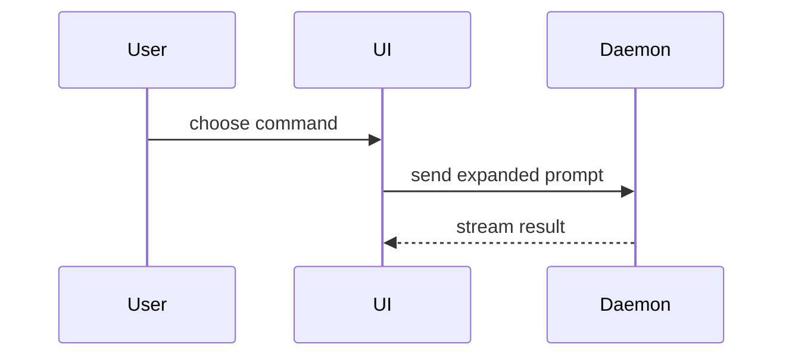

撰寫 PR 內容時，請使用此範本：

```markdown
## Summary

<diagram, diff-sketch, or tree>

## Evidence

- **Before:** <screenshot/output/failing test run>
  **After:** <screenshot/output/passing test run>

## Merge Danger

**Door:** <one-way or two-way>

<optional: description>

**Blast Radius:** <one-word description>

<optional: potential ramifications of merge>
```

<a id="sections"></a>

## 章節

略過所有前言，保持文字簡潔。使用 `GLOSSARY.md` 中使用者的領域語言。

<a id="summary"></a>

### 摘要

選擇能清楚說明重點的最小視角。

- 以偽程式碼顯示邏輯或演演算法：

```text
on(save)
  if content is unchanged
    return cached result
  write new content
  return fresh result
```

- 以呼叫樹顯示執行期控制流程：

```text
submitForm
  createSession
    persistPrompt
    launchAgent
  navigateToSession
```

- 以元件樹顯示 UI 結構，包含重要的狀態與模組邊界：

```text
<SessionPage> (apps/example/src/routes/session.tsx)
  useSessionEvents()
  <SessionToolbar>
    <RunSkillButton> (packages/ui)
```

- 以淺層檔案樹顯示檔案職責或廣泛的重構：

```text
src/
├── commands/       # parses user actions
├── sessions/       # owns session state
└── transport/      # sends API requests
```

- 使用 Mermaid 顯示元件互動、控制流程或資料流：



- 當重點在於變更內容，且周圍結構已存在時，使用 `diff`。讓 diff 的形狀與主題相符。

針對元件變更：

```diff
 <SessionPage>
   useSessionEvents()
   <SessionToolbar>
+    <RunSkillButton />
   <SessionTimeline>
+    <SkillResultCard />
```

針對檔案結構變更：

```diff
 src/
 ├── commands/
+│   └── show-me.ts       # expands the slash command
 ├── sessions/
-└── transport.ts
+└── transport/
+    ├── client.ts
+    └── stream.ts
```

針對呼叫樹或呼叫堆疊變更：

```diff
 submitForm
   createSession
     persistPrompt
+    expandSkillMention
     launchAgent
-  navigateToSession
+  navigateToSession
+    subscribeToEvents
```

針對狀態或控制流程變更：

```diff
 on(save)
-  write content
+  if content is unchanged
+    return cached result
+  write new content
+  invalidate cache
```

- 在以下情況下顯示整個區塊：大部分內容是新的、省略的上下文會隱藏所有權或順序、或使用者需要可複製的目標形狀：

```ts
function expandSkill(command: string): string {
  const skillName = command.slice(1);
  return `use the ${skillName} skill`;
}
```

<a id="guidance"></a>

#### 指引

將每個視覺元素放在其支援的簡短文字旁邊。僅保留回答使用者目前問題或解決目前討論點所需的呼叫、檔案、props、狀態與邊界。

你可以使用其中一個，也可以使用多個，但不太可能全部使用。請運用判斷力，不要讓使用者感到資訊過載。

<a id="evidence"></a>

### 證據

證明變更有效的具體證據。顯示變更前後的對比。

螢幕截圖屬於 S 級，適用於環境已設定好且變更涉及視覺效果的情況。

基於執行的證據屬於 A 級。例如測試結果、主控臺輸出。使用偽程式碼顯示現在失敗並透過的具體測試。

<a id="merge-danger"></a>

### 合併風險

描述這是單向門還是雙向門。你可以走回雙向門，但無法走回單向門。容易回滾的 PR 風險較低。涉及破壞性操作或難以反轉決策的變更屬於單向門。

影響範圍是指此 PR 引入的變更可能造成的影響或範圍。請考慮所有可能性。範例包括版面設定位移、對使用者的破壞、行動裝置響應式設計等。
